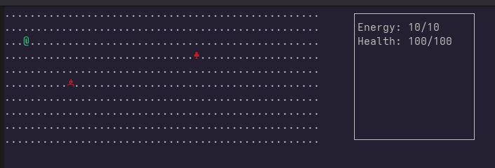

# PythonRPG

A turn-based, text-based RPG that runs in your terminal, built in Python with `curses`.

## Features

- Grid-based map with a player (`@`) you move around
- Turn-based combat: enemies only act when you spend a turn
- Energy system: moving and attacking cost energy, resting recovers it
- Enemies that chase the player and never overlap with each other or with you
- Different enemy types with their own stats (health, damage and speed)
- Side panel showing your stats

## Enemies

| Enemy | Symbol | Behavior |
|-------|--------|----------|
| Goblin | `g` | Fast and weak: moves several tiles per turn |
| Orc | `O` | Slow and strong: moves less often, but hits harder |

Enemies walk toward you and attack when they are right next to you (up, down, left or right, no diagonals).

Speed works as an accumulator: a speed of `2` means two actions per turn, and a speed of `0.5` means one action every two turns.

## How to play

**Controls**

| Key | Action |
|-----|--------|
| `W` `A` `S` `D` or arrow keys | Move (walk into an enemy to attack it) |
| `SPACE` | Rest and recover energy (the longer you rest in a row, the more you recover) |

